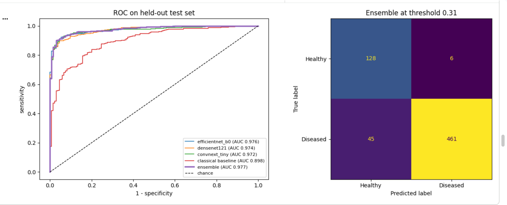
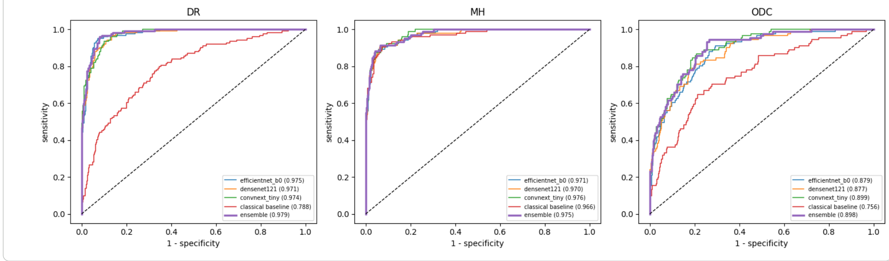

# Iluminado: Retinal Disease Screening with Deep Learning

Transfer-learning ensemble that screens retinal fundus photographs for disease, and flags three specific conditions: diabetic retinopathy (DR), media haze (MH) and optic disc cupping (ODC). Built on the public RFMiD dataset, with a Streamlit demo app.

**▶ Live demo: [try Iluminado in your browser](https://capstone-project-illuminado-retinal--image-classification-mpbt.streamlit.app/)**: pick a sample retina photo or upload your own (one image, up to 20 MB).

> **Version 2 (2026).** This is a full rebuild of my 2023 data science capstone. A code review found that the original training pipeline paired images with the wrong labels, so the original results were not valid. Every issue found and how it was fixed is listed under [What changed in v2](#what-changed-in-v2).

**Key results (held-out test set, 640 images)**

| Task | Result |
|---|---|
| Healthy vs diseased | **AUC 0.977** (95% CI 0.966–0.986); catches 91% of diseased eyes with 6 false alarms out of 134 healthy eyes |
| Diabetic retinopathy / Media haze | **AUC 0.979 / 0.975** |
| Optic disc cupping | AUC 0.898; the hardest condition, missed most often |
| vs. simple-statistics baseline | **+0.08 to +0.11 AUC**, confirming deep learning is needed |
| vs. v1 (2023) | v1 was at coin-flip level (validation AUC ≈ 0.5) because of a label-alignment bug |

## Why this project

The WHO estimates that at least 2.2 billion people live with vision impairment, and that at least 1 billion of those cases could have been prevented or have yet to be addressed ([WHO](https://www.who.int/news-room/fact-sheets/detail/blindness-and-visual-impairment)). A major barrier is the shortage of trained eye care providers. Automated screening of fundus photos, which can be taken with portable cameras by trained non-specialists, is one way to prioritise who needs an ophthalmologist first.

I had implantable collamer lens (ICL) surgery and saw first-hand how much imaging and software contribute to diagnosis. This project is my attempt to apply data science to that problem.

**Scope**: this is a research prototype trained on 3,200 images. It is not a medical device and has not been clinically validated. Even so, the results are encouraging: on held-out test images it detects retinal disease with an AUC of 0.977, so I believe it can be refined into a tool that eye clinics and hospitals could adopt at scale.

**Next step**: learn continuously from new data. The ideal next step is a pipeline that keeps improving the model as clinics contribute new photographs. Each image would be collected with patient consent and labelled by an ophthalmologist. The model would then be retrained periodically, and each new version would be tested against held-out data before it replaced the current one. This would let the model learn from more cameras, populations and rare conditions over time, while making sure every update is an improvement.

## Dataset

[Retinal Fundus Multi-Disease Image Dataset (RFMiD)](https://www.mdpi.com/2306-5729/6/2/14): 3,200 fundus images from three cameras (2009-2020), annotated by two senior retinal experts with 45 disease labels. Official split: 1,920 training, 640 validation, 640 test images. Low-quality images are included on purpose.

- About **79% of images show disease**, so "always predict diseased" is 79% accurate. Accuracy alone is therefore a misleading metric here.
- Images often carry **several labels**: 458 training images have two or more diseases.
- **No near-duplicate images across splits.** Every image was fingerprinted with a perceptual hash and no nearly identical pairs were found between training, validation and test, so test scores aren't inflated by copies of training images. Notebook 02 re-runs this check.
- Notebook 02 also tests whether the **camera** (inferred from image size) predicts the label, which would let a model take a shortcut.

The official label CSVs are in `data/`. The images (~40 GB at full size) are not in this repo; notebook 01 downloads them from a public Hugging Face mirror with no login needed (Kaggle and local copies also work).

## Approach

```
fundus photo ──► crop to fundus, square, resize ──► 3 CNN backbones ──► weighted average ──► probabilities
                 (identical in training & app)      EfficientNet-B0       (weights =          ├─ disease risk (yes/no)
                                                     DenseNet-121          validation AUC)     └─ DR / MH / ODC (independent)
                                                     ConvNeXt-Tiny
```

1. **Preprocessing.** Each image is cropped to the circular fundus and padded to a square, removing camera-specific black borders, then resized to 384 × 384.
2. **Models.** ImageNet-pretrained backbones with a new sigmoid head. Training is two-stage: the head first, then the top 30% of the backbone at a low learning rate. Augmentation (flips, 90° rotations, brightness, contrast) is fresh every epoch.
3. **Imbalance.** A class-weighted loss for both tasks.
4. **Model selection.** Early stopping, ensemble weights and decision thresholds all use the **validation** set. The test set is used once, at the end.
5. **Test-time augmentation.** Validation and test predictions are averaged over each image and its horizontal and vertical flips.
6. **Thresholds.** For disease risk, the threshold is set to catch 90% of diseased eyes on validation (screening setting, where a miss costs more than a false alarm). For DR/MH/ODC, each disease gets the threshold that maximises F1 on validation.
7. **Is the complexity earning its keep?** Every model is compared against a classical baseline (34 simple image statistics with logistic regression, random forest and gradient boosting), and a paired bootstrap tests whether the ensemble beats its best single model by more than noise.
8. **Explainability.** Grad-CAM heatmaps show which regions of the retina drove each prediction.

## Results

All numbers are on the **held-out test set** (640 images, never used for training, early stopping, thresholds or model selection). 95% confidence intervals come from 1,000 bootstrap resamples.

### Disease risk (healthy vs diseased)

| Model | AUC (95% CI) | Sensitivity | Specificity | PPV | NPV | Balanced acc. | Accuracy |
|---|---|---|---|---|---|---|---|
| EfficientNet-B0 | 0.976 (0.964–0.985) | 0.899 | 0.963 | 0.989 | 0.717 | 0.931 | 0.912 |
| DenseNet-121 | 0.974 (0.962–0.984) | 0.881 | 0.955 | 0.987 | 0.681 | 0.918 | 0.897 |
| ConvNeXt-Tiny | 0.972 (0.959–0.983) | 0.925 | 0.933 | 0.981 | 0.767 | 0.929 | 0.927 |
| **Ensemble** | **0.977 (0.966–0.986)** | **0.911** | **0.955** | **0.987** | **0.740** | **0.933** | **0.920** |
| Classical baseline (34 image statistics) | 0.898 (0.869–0.923) | 0.875 | 0.754 | 0.931 | 0.616 | 0.815 | 0.850 |
| Always "diseased" | 0.500 | 1.000 | 0.000 | 0.791 | — | 0.500 | 0.791 |
| *v1 (2023), for reference* | *≈0.45–0.55 (val)* | | *≈0–0.12* | | | | *0.73–0.78* |



**Reading the results**
- **Screening threshold.** The ensemble's threshold (0.31) was chosen on the validation set to catch 90% of diseased eyes. On the test set it caught **91.1% (461 of 506)**, so the target transferred to unseen data.
- **Few false alarms.** Only **6 of 134 healthy eyes** were flagged (specificity 95.5%); when the model says "diseased" it is right 98.7% of the time.
- **Main limitation: "healthy" calls.** 45 diseased eyes were called healthy, so a "healthy" result is right only 74% of the time (NPV). Because 79% of RFMiD images show disease, a negative result should not be treated as reassurance.
- **Deep learning earns its place.** The ensemble beats the classical baseline by **+0.079 AUC (95% CI +0.058 to +0.104)**.
- **The ensemble's gain over a single model is small.** Against the best single model chosen on validation (ConvNeXt-Tiny), the gain is **+0.005 AUC (95% CI +0.000 to +0.010)**: statistically detectable but practically minor. A single EfficientNet-B0 is almost as good at a third of the size.
- **Validation vs test.** Validation AUC was about 0.95 and test AUC 0.977. The test set was untouched and the duplicate check found no cross-split copies, so this most likely reflects the test images being somewhat easier; a fair summary is **AUC ≈ 0.95–0.98**.

### Disease type: DR, MH and ODC (multi-label)

Each disease has its own yes/no output, so an eye can be positive for several. Macro averages over the three diseases:

| Model | AUC | PR-AUC | F1 | Sensitivity | Specificity |
|---|---|---|---|---|---|
| EfficientNet-B0 | 0.942 | 0.800 | 0.703 | 0.775 | 0.919 |
| DenseNet-121 | 0.940 | 0.807 | 0.722 | 0.752 | 0.936 |
| ConvNeXt-Tiny | 0.950 | 0.824 | 0.712 | 0.771 | 0.927 |
| **Ensemble** | **0.950** | **0.830** | 0.711 | 0.712 | **0.952** |
| Classical baseline | 0.837 | 0.594 | 0.563 | 0.689 | 0.839 |
| *v1 (2023), 3-class softmax* | | | | | *accuracy 0.30–0.46* |

Per disease (ensemble). PR-AUC should be read against prevalence, which is what random guessing would score:

| Disease | Test positives | AUC | PR-AUC | Prevalence | Threshold | F1 | Sensitivity | Specificity |
|---|---|---|---|---|---|---|---|---|
| Diabetic retinopathy (DR) | 124 | 0.979 | 0.922 | 0.194 | 0.64 | 0.815 | 0.815 | 0.955 |
| Media haze (MH) | 104 | 0.975 | 0.911 | 0.162 | 0.57 | 0.785 | 0.913 | 0.920 |
| Optic disc cupping (ODC) | 91 | 0.898 | 0.658 | 0.142 | 0.77 | 0.532 | 0.407 | 0.980 |



**Reading the results**
- **DR and MH are detected very well** (AUC ≈ 0.98, PR-AUC ≈ 0.91 against a random-guess level of ≈ 0.18).
- **ODC is the hardest.** Optic disc cupping is a subtle change in the shape of the optic disc rather than a visible lesion, and at 384 px the disc occupies only a small part of the image. Its AUC (0.90) is still good, but at the F1-optimal threshold the model **misses about 6 in 10 ODC cases** (sensitivity 0.41). For screening, a lower ODC threshold would catch more cases at the cost of more false alarms; a dedicated optic-disc crop at higher resolution is the most promising fix.
- **Thresholds were tuned for F1 on validation**, which favours specificity here (0.95) over sensitivity (0.71). The threshold is a clinical choice, not a fixed property of the model.
- **Deep learning earns its place overall:** +0.114 macro AUC over the classical baseline (95% CI +0.093 to +0.137).
- **Except for media haze.** Simple image statistics reach AUC 0.966 for MH, almost matching the CNNs (0.975). That makes sense: media haze is a loss of clarity across the whole image, which the baseline's sharpness and contrast features measure directly. For DR (0.788 vs 0.979) and ODC (0.756 vs 0.898), which depend on small local structures, the CNNs are far better.
- **The ensemble does not beat its best single model here.** Against ConvNeXt-Tiny (chosen on validation) the difference is +0.001 macro AUC (95% CI −0.004 to +0.005): no clear difference. For this task a single ConvNeXt-Tiny is as good and simpler.
- **Compared with v1**, which used a 3-class softmax on 724 images and scored below the "always predict DR" baseline, the multi-label model uses all 1,920 training images and can represent eyes with more than one disease.

## What changed in v2

| # | Issue in v1 | Effect | Fix |
|---|---|---|---|
| 1 | Features came from a shuffled generator, labels from `.labels` in folder order | Every model trained on scrambled labels; validation AUC ≈ 0.5 | `tf.data` keeps each image and its label together through shuffling (covered by a test) |
| 2 | Test set used as `validation_data` with early stopping | Test scores were optimistic | Official validation split for all tuning; test used once |
| 3 | Multi-class models all reused InceptionV3 features | "Six architectures" were one feature extractor | Each backbone trained end to end |
| 4 | Images moved into one folder per disease | Multi-label images lost labels; ~150 target-disease images dropped | Manifest keeps all labels; multi-label sigmoid model |
| 5 | Disease model trained only on images with DR/MH/ODC | Couldn't learn "none of these" | Trained on all images |
| 6 | `rescale=1/255` for every backbone | EfficientNet/ResNeXt collapsed to constant "diseased" | Each model does its own correct scaling internally |
| 7 | Augmented features extracted once | One frozen augmentation per image | Fresh augmentation every epoch |
| 8 | Declared input sizes didn't match the 256 px generator default | Unclear what actually ran | One `IMG_SIZE`, used everywhere |
| 9 | Accuracy as headline; no baseline | Results (0.73-0.78) were below the 0.79 do-nothing baseline | AUC, sensitivity/specificity, bootstrap CIs, baseline row |
| 10 | "Ensemble" in title, no ensemble in code | Claim not supported | Validation-AUC-weighted ensemble |
| 11 | App loaded a non-existent `model.keras`, wrong size, no scaling, mismatched backbone/head | App could not give valid predictions | App shares the training preprocessing and loads the saved ensemble |
| 12 | App saved every upload to disk, even without consent | Privacy risk for medical images | Uploads processed in memory only, never stored |
| 13 | No disclaimer; raw probability array shown | Could be mistaken for a diagnosis | Clear "not a medical device" notice and plain-language output |
| 14 | Absolute `/Users/...` paths, `cd` cells, no requirements | Not reproducible | Config cells, `requirements.txt`, runs on Colab |
| 15 | README images pointed at `localhost` | Broken for everyone else | Images stored in the repo |
| 16 | "SE-ResNeXt" was plain ResNeXt-50 | Mislabelled | Replaced with clearly named backbones |
| 17 | No check for duplicate images or camera shortcuts | Leakage or shortcut learning would go unnoticed | Perceptual-hash duplicate check (none found across splits) and camera-vs-label test |
| 18 | No simpler model to compare against | No way to tell whether deep learning was needed | Classical 34-feature baseline and a paired test of ensemble vs best single model |

## Repository layout

```
iluminado/                      shared code used by notebooks and app
  data.py                       manifest, fundus crop, caching, tf.data pipeline
  download.py                   Hugging Face download with label parsing
  audit.py                      near-duplicate and camera-shortcut checks
  baseline.py                   34-feature classical baseline
  models.py                     backbones, weighted loss, two-stage training
  evaluate.py                   thresholds, clinical metrics, bootstrap CIs, TTA, ensembling
  gradcam.py                    Grad-CAM heatmaps
notebooks/
  01_data_preparation.ipynb     download, manifest, crop + cache
  02_eda.ipynb                  balance, baseline, co-occurrence, camera and duplicate checks
  03_disease_risk_binary.ipynb  healthy vs diseased + ensemble
  04_disease_type_multilabel.ipynb  DR / MH / ODC + ensemble
app/streamlit_app.py            demo app (sample images in app/samples)
scripts/export_demo.py          packages a small model for deployment
scripts/convert_tflite.py       converts it to TensorFlow Lite for a low-memory app
data/                           RFMiD label CSVs
models/                         trained models + ensemble JSON (added after training)
tests/test_pipeline.py          synthetic-data tests (no dataset or GPU needed)
```

## How to run

**Train (Google Colab, free GPU)**
1. Open each notebook in Colab (File → Open notebook → GitHub → this repo) and set Runtime → Change runtime type → GPU.
2. Run 01 → 02 → 03 → 04. Outputs are saved to `MyDrive/iluminado/`, so a disconnect doesn't lose finished models.
3. Notebook 01 downloads RFMiD from Hugging Face (no account needed, about 8 GB). It can also use Kaggle or a copy you already have.

**Run the app locally**
```bash
pip install -r app/requirements.txt
streamlit run app/streamlit_app.py
```

**Deploy the demo (Streamlit Community Cloud)**
1. In Colab, after notebooks 03 and 04, run `python scripts/export_demo.py`. It packages the EfficientNet-B0 model for each task (the full ensemble is too large for GitHub), recomputes that model's own thresholds on the validation set and adds four test-set sample images. Unzip the result into the repo.
2. Run `python scripts/convert_tflite.py` (needs TensorFlow). It converts both models to TensorFlow Lite, builds the heatmap into each model, and checks the converted outputs match the originals.
3. Push, then on [share.streamlit.io](https://share.streamlit.io) create an app from this repo with main file `app/streamlit_app.py` and Python 3.12 under *Advanced settings*.

**Why TensorFlow Lite:** full TensorFlow alone uses about 640 MB of memory, and the app peaked at about 1.3 GB, which crashed on free hosting. With TensorFlow Lite the app peaks at about 380 MB and starts in under a second, with identical predictions (max difference < 0.0001). The heatmap is the class activation map, which for this architecture (global average pooling followed by one dense layer) is mathematically identical to Grad-CAM, so no gradients are needed at serving time.

**Upload limit:** one image at a time, up to 20 MB (set in `.streamlit/config.toml`); larger photos are shrunk to 2,048 px before analysis.

The demo uses a single EfficientNet-B0 per task (disease-risk test AUC 0.976 vs 0.977 for the ensemble). Its exact test metrics are in `models/demo_test_metrics.json`.

**Tests**
```bash
python -m pytest tests -q
```

## Limitations and next steps

- 3,200 images from one dataset; performance on other cameras and populations is unknown. External validation (for example on ODIR or APTOS) is the most important next step.
- Only 3 of 45 conditions are classified individually, and optic disc cupping is detected much less reliably than DR and MH.
- Labels come from two graders, so label noise is likely for subtle cases.
- Grad-CAM shows where the model looked, not whether its reasoning is clinically correct.

## References

1. Pachade et al. (2021). [Retinal Fundus Multi-Disease Image Dataset (RFMiD)](https://www.mdpi.com/2306-5729/6/2/14). *Data*, 6(2), 14.
2. World Health Organization. [Blindness and vision impairment](https://www.who.int/news-room/fact-sheets/detail/blindness-and-visual-impairment).
3. Selvaraju et al. (2017). Grad-CAM: Visual explanations from deep networks via gradient-based localization. *ICCV*.
